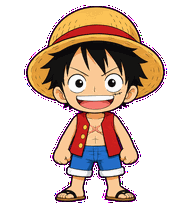

# Kaine Pet

A cheerful Luffy-style animated companion, created for Rothanak's ChatGPT Work pet.

## Files

- `assets/kaine-spritesheet.png`: transparent 1536 × 2288 PNG atlas.
- `assets/gifs/`: nine animation previews.
- `assets/frames/`: individual transparent 192 × 208 PNG frames, including 16 look directions.
- `manifest.json`: zero-based atlas rows, frame counts, and look-direction positions.
- `index.html`: local GIF viewer; open in a browser.

## Reuse in other software

For websites or presentations that support animated GIFs, use the GIF files directly. For Unity, Godot, a desktop mascot, or another animation engine, import the individual PNG frames or slice the atlas into 192 × 208 cells. Play each state's frames in order and choose the playback speed in your application. GIF previews are visual references, not a required runtime format.

Look angles follow screen coordinates: 0° up, 90° right, 180° down, 270° left. The last two atlas rows contain all 16 directions. The first nine rows contain the states listed in the manifest; unused cells are transparent.

These files are artwork assets. They do not include a desktop mascot application or automatically install Kaine into another program. Each target application needs its own animation or integration code. Importing the atlas into ChatGPT Work also requires its pet upload workflow.

## Credits

AI-generated, unofficial fan artwork inspired by Monkey D. Luffy from One Piece. This project is not affiliated with One Piece's creators or rights holders. No license to the underlying character is granted by this repository.
